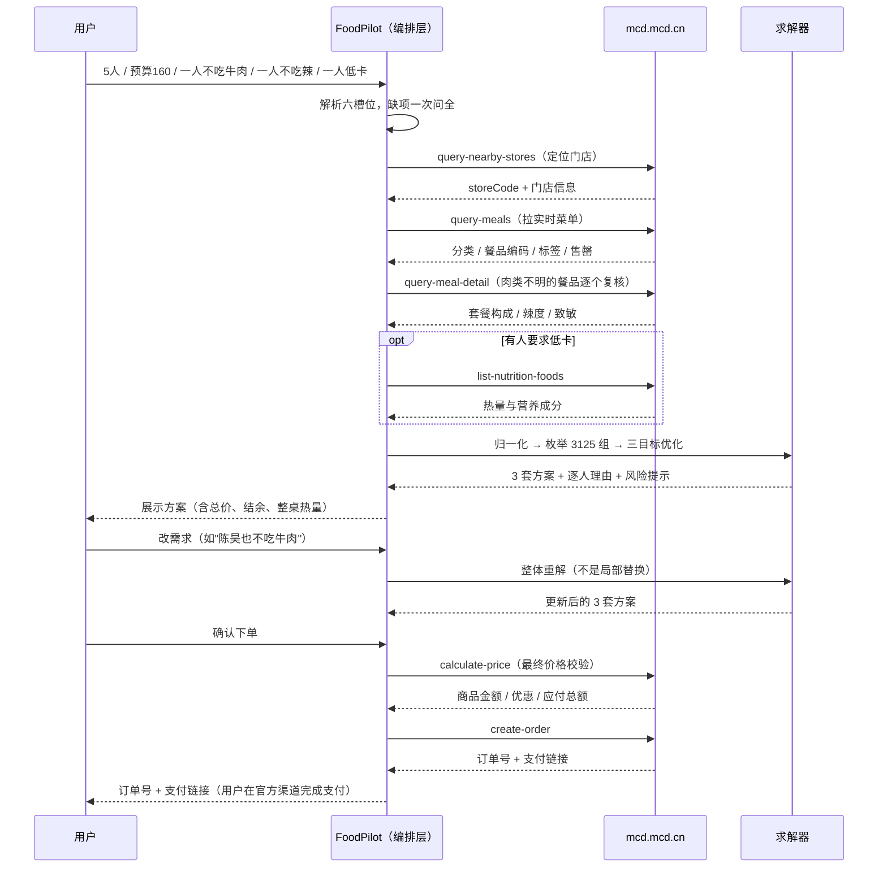
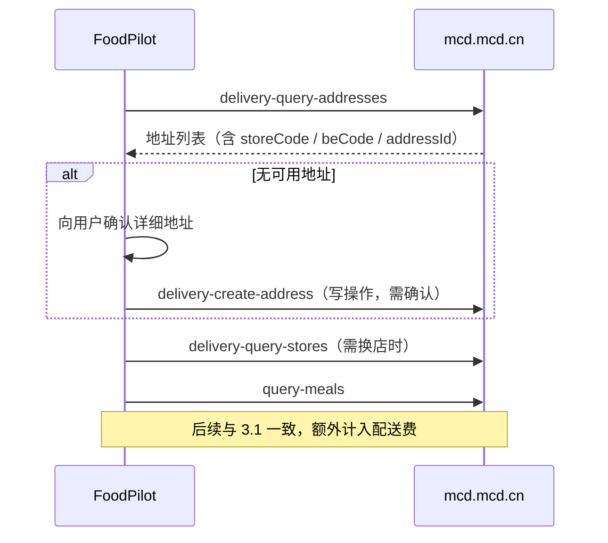
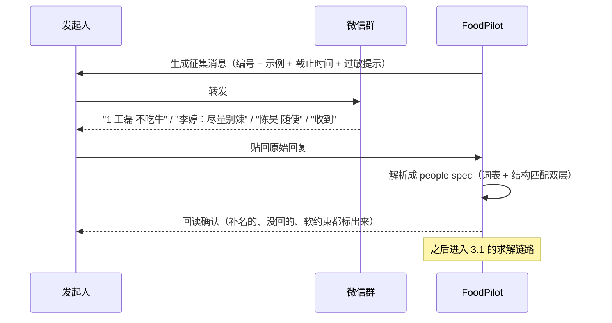

# 麦当劳 MCP 集成说明

本文说明本项目**实际使用了哪个 MCP Server、调用了哪些 Tool、按什么顺序调用、以及这套组合解决了什么业务问题**。

一句话结论：**本项目没有自建 MCP Server，也不应该自建。** 麦当劳中国已提供官方 MCP 服务，本项目的价值在于它之上的**编排层**——官方工具是原子的，而"五个人预算 160 且各有忌口"是一道组合优化题，原子工具无法直接回答。

---

## 一、使用的 MCP Server

| 项 | 值 |
| --- | --- |
| Server 名称 | 麦当劳中国 MCP 服务（McDonald's China MCP Server） |
| 接入地址 | `https://mcp.mcd.cn` |
| 传输协议 | Streamable HTTP |
| 鉴权方式 | `Authorization: Bearer <MCP_TOKEN>` |
| Token 获取 | `open.mcd.cn/mcp` 手机号验证登录 → 控制台「激活」→ 复制 Token |
| 服务范围 | 中国大陆（不含港澳台） |
| 版本 | 1.0.9（2026-09-10，官方最新） |
| 限流 | 600 次/分钟，超限返回 `429`；Token 无效返回 `401` |
| 官方文档 | https://github.com/M-China/mcd-mcp-server |
| 计费 | 免费，无调用次数上限 |

**WorkBuddy 中的配置方式**（`~/.workbuddy/mcp.json`）：

```json
{
  "mcpServers": {
    "mcd-mcp": {
      "type": "streamableHttp",
      "url": "https://mcp.mcd.cn",
      "headers": {
        "Authorization": "Bearer <YOUR_MCP_TOKEN>"
      },
      "disabled": false
    }
  }
}
```

> Token 是个人身份凭证，**不入库、不写进任何交付物**。仓库内所有配置均使用 `<YOUR_MCP_TOKEN>` 占位符。

---

## 二、实际调用的 Tool

官方共开放 33 个 Tool。本项目按其职责分四组使用，其中**组 1–3 为必需链路，组 4 为条件触发**。

### 组 1：定门店与取菜单（必需）

| Tool | 用途 | 所在环节 |
| --- | --- | --- |
| `query-nearby-stores` | 按地址/地标查附近门店 | 到店自取、堂食、得来速 |
| `delivery-query-addresses` | 查用户已有配送地址 | 麦乐送外送 |
| `delivery-query-stores` | 查收货地址附近可配送门店 | 麦乐送外送（需换店时） |
| `query-meals` | 拉当前门店**实时菜单**（分类、餐品编码、标签、售罄状态） | 所有场景 |

`query-meals` 是整条链路的起点——菜单、编码、售罄状态全部以它为准，本项目**不内置任何菜品数据**，演示用快照仅用于离线自测。

### 组 2：约束复核与营养（必需 / 条件必需）

| Tool | 用途 | 触发条件 |
| --- | --- | --- |
| `query-meal-detail` | 查套餐构成、可替换项、辣度与致敏信息 | **凡涉及忌口必须查**：归一化阶段标记为 `meat=unknown` 的餐品，一律回查此项，且不得分配给有忌口的人 |
| `list-nutrition-foods` | 查热量、蛋白质、脂肪、碳水、钠、钙 | 有人提出低卡/减脂要求时 |

> 这是本项目最重要的一条安全设计：**菜名关键词识别一定会误判**（例如「吉士」实为牛肉），所以识别不出的餐品不允许"猜"，必须回查 `query-meal-detail`。宁可方案丑，不可方案错。

### 组 3：价格校验与下单（必需 / 下单时）

| Tool | 用途 | 说明 |
| --- | --- | --- |
| `calculate-price` | 按商品列表（可含券）计算商品金额、配送费、优惠金额、应付总额 | **必须调用**，本项目严禁自行加总；券与配送费只有此接口知道 |
| `create-order` | 创建订单，返回订单号与**支付链接** | 写操作，**必须用户明确确认后**才调用 |
| `query-order` | 查订单状态、内容、配送进度 | 下单后跟进 |
| `cancel-order` | 取消订单 | 写操作，同样需要确认 |

### 组 4：优惠与辅助（条件触发，不默认执行）

| Tool | 用途 | 本项目策略 |
| --- | --- | --- |
| `query-my-coupons` | 查账户已有券 | 用户提出省钱诉求时 |
| `query-store-coupons` | 查当前门店可用券 | 同上 |
| `auto-bind-coupons` | 一键领取全部可领券 | **不自动执行**。批量改变账户状态，须先说明会领什么、再征得同意 |
| `delivery-create-address` | 新增配送地址 | **不自动执行**，属账户写操作 |
| `now-time-info` | 获取当前时间 | 涉及"今天/本周/月底"判断时，避免用模型自己的时间直觉 |

### 未被本项目使用的 Tool（及原因）

| Tool 组 | 未使用原因 |
| --- | --- |
| `mall-points-products` / `mall-product-detail` / `mall-create-order` / `mall-order-list` / `mall-order-detail` | 积分商城是独立业务线，与"多人配餐协调"无直接关系；混进来只会让 MVP 失焦 |
| `draw-lottery` / `query-lottery-info` / `query-my-prizes` | 积分抽奖属营销玩法，非本轮目标 |
| `query-party-city` / `query-party-store` / `query-partystore-date` / `query-partystore-session` / `party-order-create` | 主题活动预约（派对、品鉴会）场景差异大，需单独设计确认流 |
| `query-meal-assistance` | 企业团餐助餐服务，本项目覆盖"多人拼单"而非"企业团餐对接" |
| `order-list` / `campaign-calendar` / `available-coupons` / `query-my-account` | 非关键路径，或将来的"复购推荐""活动提醒"扩展用 |

> 33 个工具全接一遍不是本事，**知道哪些不该用**才是。工具面越宽，Agent 的误触发概率越高。

---

## 三、调用流程

### 3.1 到店自取（本项目主推链路）



### 3.2 麦乐送外送

差异只在定门店环节：



**外送三件套**：`storeCode` + `beCode` + `addressId` 必须齐备，且**不可与自取场景的门店字段混用**。

### 3.3 群聊征集（多人场景的前置环节）



---

## 四、为什么在官方 MCP 之上还需要一层

官方 33 个 Tool 都是**原子能力**：查门店、查菜单、算价格、下单。它们回答的是"这个餐品多少钱""这个店有什么"。

但赛题问的是：**5 个人、预算 160、一个不吃牛肉、一个不吃辣、一个要低卡，怎么配？**

这个问题需要：约束可行性判定 → 组合枚举 → 多目标优化 → 理由生成 → 变更后整体重解。**这不是任何单个 Tool 的职责，也不该由大模型"想一想"来承担。**

所以本项目做了明确分工：

| 层 | 承担 | 明确不承担 |
| --- | --- | --- |
| MCP Server | 门店、菜单、营养、券、价格、订单的**事实来源** | 不做组合优化 |
| 求解器 | 可行性判定、枚举、三目标优化、可验证理由 | 不做自然语言理解 |
| Agent（WorkBuddy + SKILL.md） | 听懂人话、追问缺失项、编排调用顺序、解释结果 | **不加总金额、不校验约束、不猜最优解** |

这个分工有一处硬性后果：**页面上、对话里的每一个金额，都必须能追溯到 `calculate-price` 或求解器的同一次输出，没有任何一处是模型算的。**

---

## 五、失败处理

| 状况 | 处理 |
| --- | --- |
| `401` Token 无效/过期 | 引导用户重新激活 Token 并更新配置，不重试 |
| `429` 限流（>600 次/分） | 停止重试，告知用户降低频率；**不循环打接口** |
| 餐品售罄 | 从候选中剔除，并明确告知已排除 |
| 肉类成分无法判定 | 回查 `query-meal-detail`；仍无法确认则**不分配给有忌口的人**，并输出复核提示 |
| 预算内无可行解 | 不报错，给出诊断："只求人人有主餐的最低预算约 ¥80，可放宽预算/热量上限/换门店" |
| 接口返回与求解器不一致 | 以 `calculate-price` 为准，如实说明差额来源（通常为券或配送费） |

---

## 六、安全与合规边界

1. **不代付**：`create-order` 只返回订单号与支付链接，支付必须在麦当劳官方渠道由本人完成，AI 不接触任何支付凭证。
2. **写操作需显式确认**：`create-order` / `cancel-order` / `delivery-create-address` / `auto-bind-coupons` 四类，未获明确同意一律不调用。"帮我看看"不等于"帮我下单"。
3. **不刷券、不跨账号**：不做批量领券、不代领他人优惠、不读取非本人会员数据。
4. **过敏与宗教禁忌零容忍**，但不做绝对安全承诺——餐品以门店实际制作为准。
5. **热量估算必须标注**：接口无数据时按品类估算，输出标注 `estimate`，不作为营养依据。
6. **Token 不入库**，仓库内仅占位符。

---

## 七、业务价值

### 7.1 对用户

多人点餐的真实成本不在"选什么"，在**协调**：收集忌口、算预算、改需求、重算——手动做通常要 10 分钟以上，且容易算错。

本项目把它压到一次输入 + 一次确认。更重要的是**改需求不用重来**：加一条忌口，整套方案在本地 1 秒内重解，因为腾出来的预算会改变其他所有人的最优解。

### 7.2 对麦当劳 MCP 平台

| 维度 | 本项目的贡献 |
| --- | --- |
| 调用深度 | 一次完整点餐触发 **6–8 次** Tool 调用（定店 → 菜单 → 详情 → 营养 → 价格 → 下单），而非单点查询 |
| 场景拓展 | 证明 MCP 不只服务"一个人随便点"，还能支撑**多人约束协调**这类高复杂度场景 |
| 组合价值 | 单工具是能力，组合起来才解决真实问题——这正是 MCP 生态需要被证明的部分 |
| 可复用范式 | 三层分工（事实 / 求解 / 表达）可平移到其他餐饮或零售场景 |

### 7.3 对生态

本项目的存在本身是一个结论：**官方 MCP 足够好，好到第三方不需要再造一个。**

真正稀缺的不是协议层，而是**知道怎么把原子工具编排成一个能解决冲突的系统**。这也正是本项目把 60% 的工程量花在求解器与测试上、而不是花在接口封装上的原因。
