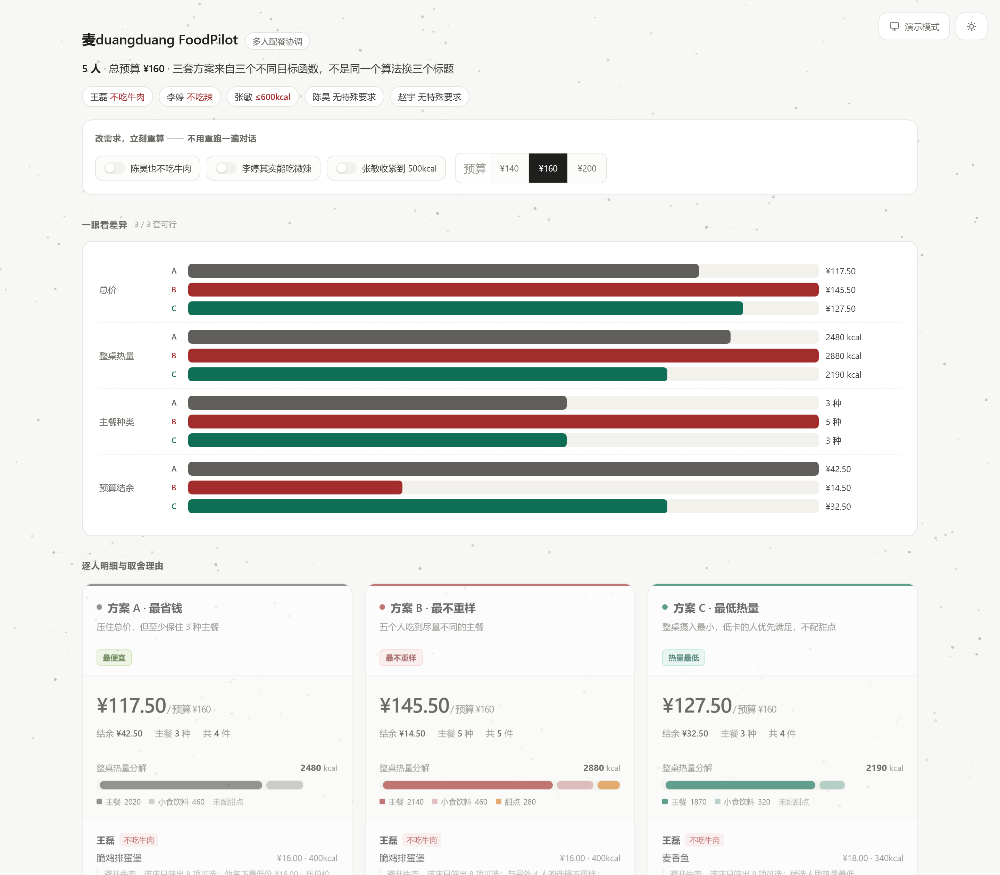

# 麦duangduang FoodPilot

> 把五个人的嘴，协调成一张能下单的单子。



> **参赛说明**：本仓库为麦当劳程序员节创意开发大赛参赛作品，由参赛者独立开发，**非麦当劳官方产品**。项目输出仅供参考，不构成医疗、营养或其他专业建议；餐品信息、价格及供应状态以麦当劳官方渠道的实时结果为准。参赛声明见 [CONTEST_DECLARATION.md](CONTEST_DECLARATION.md)（官方原文，未作任何修改）。

多人点麦当劳的真实卡点不是「吃什么」，是**协调**：5 个人、160 元预算、一个不吃牛肉、一个不能吃辣、一个要控热量。谁来算？算完谁改？改完谁重算？

FoodPilot 把这件事做成一个**可解释、可调整的 Agent**，而不是又一个"帮你推荐汉堡"的对话壳。

---

## 目标用户

**主要：3 人以上的拼单发起人。**

公司下午茶、团队午餐、加班晚餐的组织者——通常是行政、组长，或者那个总被推出来点单的人。他的负担不是"选什么好吃"，而是要在群里收集五个人的忌口、在固定预算里配平、并且在有人说"等一下我不吃这个"之后全部重算。一次决策涉及 4–10 人，有硬预算上限，且总有人有忌口或减脂需求。

**次要：有明确约束的个人。**

控卡、忌口、想省钱但懒得算券的人。单人场景本项目不是最优选择（直接点更快），但同一套约束求解逻辑依然成立。

**明确不适用：**

- **一个人随便吃点什么** —— 本项目的编排成本高于收益，直接用官方小程序更快。这也是 SKILL.md 里写明的"不该用"场景
- **只想看推荐、不打算下单** —— 本项目的终点是下单前确认单，不做"推荐完就结束"
- **想跨平台比价** —— 只对接麦当劳官方 MCP，不抓美团/饿了么

---

## 为什么不用纯 Prompt 做

这是本项目最重要的一条设计判断。

五个人的约束 + 预算 + 热量，是**组合优化问题**。让大模型"想一想"会得到三个结果：看起来合理的方案、算错的账、以及一份无法复现的理由。预算 160 算出 163.5 这种错误，人眼要核对六行才看得出来。

所以本项目把职责切开：

| 层 | 负责 | 不负责 |
| --- | --- | --- |
| 大模型 | 听懂人话（谁不吃什么、预算多少）、追问缺失项、把方案讲成可读的一段话 | 不做金额加总、不做约束校验、不算最优解 |
| `meal_solver.py` | 可行性判定、组合枚举、目标函数优化、生成可验证的理由 | 不做自然语言理解、不写话术 |

**所有数字只有脚本这一个来源。** 这条纪律写在 SKILL.md 的第一节，也写进了自检脚本。

---

## 三套方案 ≠ 一个算法换三个标题

常见做法是调三组权重、跑同一个贪心，然后起三个名字。用户一切方案就发现"根本没区别"。

本项目用**三种不同的目标函数**，枚举全部候选组合后各自取最优：

| 方案 | 目标函数 | 典型结果（5 人 / ¥160） |
| --- | --- | --- |
| A 最省钱 | `min 总价`，附多样性下限（≥3 种） | ¥117.50，3 种主餐，结余 ¥42.50 |
| B 最不重样 | `max 主餐种类`（同种类下取便宜） | ¥145.50，5 种主餐，无人同款 |
| C 最低热量 | `min 整桌热量`，低卡名额加权、禁配甜点 | ¥127.50，3 种主餐，2190kcal |

三套方案的差异是**结构性的**，能一句话讲清楚该选哪个。`compare` 字段会自动生成这句建议。

---

## 「可解释」到底解释什么

不是"这款最受欢迎"，而是**为什么是它、牺牲了什么**。真实输出：

```
王磊（不吃牛肉）  那么大鸡排  ¥22.00  480kcal
   ↳ 避开牛肉，该店只筛出 8 项可选；比最低价的脆鸡排蛋堡贵 ¥6.00，
     用来凑够 4 种不同主餐，避免整桌一个味

张敏（≤600kcal）  双层吉士堡  ¥23.00  450kcal  ← C 方案
   ↳ 比最低卡的麦香鱼高 110kcal，用来凑够不同主餐，
     免得整桌都是一模一样的低卡餐
```

每条理由都包含**可验证的事实**（候选数量、价差、热量差）和**本次取舍**。用户不同意，可以顺着理由直接反驳："那别凑种类了，就吃便宜的"——这句话能被 `--exclude` 或降低 `min_unique` 直接消化。

---

## 一页纸对比（给不看你代码的人看）

架构讲得再清楚，也不如一张能三秒看完的对比页。

但页面上的数字是最不能错的东西，所以它是**生成出来的**，不是手写的：

```bash
python build_compare_page.py plan.json --menu menu.json -o compare.html
```

`demo/compare.html` 单文件、零外部依赖、断网可开。内容包括：

- **调节台（最重要的一个）** —— 三个开关加三档预算：`陈昊也不吃牛肉` / `李婷其实能吃微辣` / `张敏收紧到 500kcal` / `¥140 · ¥160 · ¥200`。点一下，三套方案、指标条、结论全部在本地重算，不发请求、不重跑对话。这是"可调整"三个字的直接证据
- **场景头** —— 人数、预算，以及每人的约束徽章（红色小标签，一眼看到谁不能吃啥），开关一改跟着变
- **四行横向指标条** —— 总价 / 整桌热量 / 主餐种类 / 预算结余，同一量纲直接比长短
- **每张卡片一条热量堆叠条** —— 主餐 / 小食饮料 / 甜点**三段分色**。甜点单独用橙色，是为了让"低卡方案砍掉甜点"这个决策一眼可见：B 方案那份麦旋风是 280kcal，占整桌一成，C 方案整条短一截且没有橙色段
- **三列方案卡** —— 每人的菜品、单价、热量，以及**那条取舍理由**
- **可展开的备选菜品** —— 每套方案底部可展开，逐人列出 3 个备选，并标注换菜的价差（`+2.00` / `-6.00`）与热量差，回答"为什么不选那个"
- **演示模式** —— 一键整体放大 18% 并收窄版心、隐藏脚注。3 分钟演示要投大屏，11.5px 的小字在后排是不存在的
- **日夜双主题** —— 跟随系统偏好，也可手动切换并记忆
- **400 粒子背景** —— canvas 绘制，轻量邻近连线，透明度压得很低，不干扰阅读

<details>
<summary>深色主题预览</summary>


</details>

### 两个求解器，靠测试保证不漂移

页面要"双击即开、断网可用、点开关立刻重算"，就不能靠本地服务。代价是求解器有两份实现：Python（CLI 与生成器用）和 JS（页面交互用）。

这不是可以靠自觉维持的，所以做了三层保障：

| 层 | 手段 | 抓什么 |
| --- | --- | --- |
| 源码 | `solver_core.js` 是唯一 JS 源码，生成器读它内嵌，不存副本 | 防止生成器里藏第三份 |
| 测试 | `test_parity.js` 逐项比对两个求解器的总价 / 种类 / 热量 / **选品编码** / **理由文案** | 漂移、排序偏差、文案悄悄变形 |
| 运行时 | 页面启动时用内嵌 baseline（Python 的当次结果）自校，不一致在页脚告警 | 万一还是漏了，现场能被看见 |

```bash
node test_parity.js    # → 等价性通过：JS 求解器与 Python 求解器输出完全一致
```

另外 `test_interact.js` 把调节台 24 种组合全跑一遍，确认「不抛异常、不出 NaN、可行方案不超预算、无忌口违规、无解时正确降级到诊断」。演示时用户会随手点，这 24 组必须都站得住。

手写页面在算法改完之后就过期了。而"改了算法忘了改页面"恰好是这类作品最容易出的丑——评委指着页面上的数字问一句就穿。生成器保证页面上的每个数字只有一个来源，并且在生成时校验"堆叠条三段之和 = 求解器报的总热量"，不一致直接打警告。

---

## 入口在群里，不在对话框

多人点餐的真实起点是微信群，不是 AI 对话框。发起人说不出所有同事的忌口，所以流程第一环是**征集**，而不是让 AI 猜。

`group_prompt.py` 管两头：

**发出去**——生成一条能直接转发的消息，带编号、带示例、带截止时间，并且专门要求"有过敏的标过敏"：

```
【麦当劳拼单】5 人 · 预算 ¥160 · 望京SOHO店到店自取
12:00 截止，我统一下单。

每人回一行：编号 + 忌口。没忌口就写「都行」
1 王磊
2 李婷
...

忌口直接写白话：不吃牛肉 / 不吃辣 / 低卡 / 不吃鸡 / 吃素
例：2 李婷 不吃辣

有过敏的一定标「过敏」两个字，我按零容忍配。
```

**收回来**——解析群里那些不按格式的回复，直接产出 `people spec`：

| 群里说 | 解析成 |
| --- | --- |
| `1 王磊 不吃牛` | `nobeef` |
| `李婷：尽量别辣` | `nospicy` + 标记「软要求已按硬处理」 |
| `3、张敏 减脂` | `lowcal500` |
| `陈昊 随便` / `都行` | 无约束 |
| `赵宇 同上` | 复制上一人约束，并标注 |
| `我不吃鱼`（没名字） | 按名单补名，并说明"名字是我补的" |
| `收到` / `哈哈` | 跳过，不算一份订单 |

两个设计点值得说：

1. **词表永远补不全**。人说「牛的不行」「牛肉我拒绝」，不写「不吃牛肉」。所以除了词表，还有一层**结构匹配**：肉类字 + 3 字内的否定词，双向扫。
2. **软要求按硬约束处理**。`尽量别辣` 会被当成 `nospicy`，代价是少两个选项，收益是不会给怕辣的人点到麦辣。但必须回头告诉用户"这条是我保守处理的，能放宽的话方案会更多"。宁可方案丑，不可方案错。

---

## 架构

```
用户一句话
   ↓
WorkBuddy（解析六槽位：人数/预算/就餐方式/地点/每人约束/特殊要求）
   ↓
麦当劳官方 MCP（mcp.mcd.cn，33 个工具）
   ├─ delivery-query-addresses / query-nearby-stores  定门店
   ├─ query-meals                                      拉实时菜单
   ├─ query-meal-detail                                复核忌口（必做）
   ├─ list-nutrition-foods                             热量
   └─ calculate-price / create-order                   校验与下单
   ↓
normalize_menu.py   洗字段（分→元、识别肉类/辣度/品类）
   ↓
meal_solver.py      枚举 + 三目标优化 + 生成理由 + 不变量校验
   ↓
方案展示 → 改需求 → 重算 → 确认单 → create-order → 官方支付链接
```

---

## 快速开始

前置：拿到麦当劳 MCP Token（`open.mcd.cn/mcp` 手机号登录 → 控制台激活），
填入 `~/.workbuddy/mcp.json` 的 `mcd-mcp.headers.Authorization`，`disabled` 改 `false`，重启后点「信任」。

**不接 Token 也能验证内核**（本仓库自带 18 项演示菜单）：

```bash
cd scripts
python normalize_menu.py ../demo/raw_menu_demo.json -o ../demo/menu_demo.json

python meal_solver.py --menu ../demo/menu_demo.json \
  --people "王磊:nobeef;李婷:nospicy;张敏:lowcal600;陈昊:;赵宇:" \
  --budget 160

python smoke_test.py   # 6 个极端场景的不变量自检
```

群聊征集（发模板 → 收回复 → 出 spec）：

```bash
python group_prompt.py make --count 5 --budget 160 --store "望京SOHO店" --deadline "12:00"

python group_prompt.py parse ../demo/replies_demo.txt --expect 5 \
  --names "王磊,李婷,张敏,陈昊,赵宇"
# 输出末尾给出一行 people spec，可直接喂给 meal_solver 的 --people
```

生成一页纸对比（给评委/客户看）：

```bash
python meal_solver.py --menu ../demo/menu_demo.json \
  --people "王磊:nobeef;李婷:nospicy;张敏:lowcal600;陈昊:;赵宇:" \
  --budget 160 --format json -o ../demo/plan.json

python build_compare_page.py ../demo/plan.json \
  --menu ../demo/menu_demo.json -o ../demo/compare.html
```

对比页出厂检查（含把页面脚本导出给 `node --check` 验语法）：

```bash
python check_page.py ../demo/compare.html
node --check _check.js
```

演示「临时改禁忌、实时重算」：

```bash
python meal_solver.py --menu ../demo/menu_demo.json \
  --people "王磊:nobeef;李婷:nospicy;张敏:lowcal600;陈昊:;赵宇:" \
  --budget 160 --add-avoid "陈昊:beef"
```

---

## 自检（不变量，不是"看起来对不对"）

`smoke_test.py` 覆盖 6 个场景：标准五人局、改禁忌重算、预算压到极限、单人低卡、全员忌口重叠、预算很宽。

每个可行方案都必须通过：预算不超 / 忌口不违反 / 辣度不违反 / 热量上限不违反 / 每人恰好一份主餐 / 方案自报状态与实际一致。

```
[OK  3/3 套可行] 标准五人局  (5 人 / ¥160)
[OK  0/3 套可行] 预算压到极限  (5 人 / ¥70)
    ! 只求人人有主餐的最低预算约 ¥80.00
    ! 可放宽的方向：提高预算 / 提高热量上限 / 换备货更全的门店
```

无解时不是报错，而是**告诉用户该松哪条约束**。

---

## 已知边界

- **菜名识别是启发式的**。「吉士」其实是牛肉这类情况会误判，所以凡 `meat=unknown` 都强制要求回查 `query-meal-detail`，且不计入"可安全分配"。
- **热量可能来自估算**。接口没给时按品类估，输出会标 `estimate`，不当作营养依据。
- **不代付**。`create-order` 只返回订单号和支付链接，支付必须走官方渠道。
- **套餐内换品**受接口版本限制（1.0.5 起支持），可用项以 `query-meal-detail` 返回为准。
- 过敏与宗教禁忌只做规避与提示，**不做绝对安全承诺**。

## 文件

```
SKILL.md                      Agent 行为规范（四阶段工作流 + 红线）
CONTEST_DECLARATION.md        参赛声明（赛事官方原文，未作任何修改）
MCP_INTEGRATION.md            麦当劳 MCP 集成说明（Server / Tool / 调用流程 / 业务价值）
mcp-config.example.json       MCP 配置示例（脱敏，仅环境变量占位符）
scripts/normalize_menu.py     菜单归一化（字段洗版 + 品类/肉类/辣度识别）
scripts/meal_solver.py        求解器 Python 版（枚举 + 三目标 + 理由生成 + 校验）
scripts/solver_core.js        求解器 JS 版（唯一源码，页面内嵌 / Node 测试共用同一份）
scripts/build_compare_page.py 对比页生成器（读 solver_core.js 内嵌，不维护副本）
scripts/group_prompt.py       群聊征集（生成模板 + 解析乱回复 → people spec）
scripts/smoke_test.py         求解器不变量自检（6 场景）
scripts/test_parity.js        Python ↔ JS 求解器等价性验证
scripts/test_interact.js      调节台 24 组组合自检
scripts/check_page.py         对比页出厂检查（并导出页面脚本供 node --check）
demo/raw_menu_demo.json       演示用原始菜单（故意混用字段名、价格用分）
demo/menu_demo.json           归一化结果
demo/replies_demo.txt         演示用群回复（故意不按格式）
demo/plan.json                求解器输出快照
demo/compare.html             生成好的对比页（双击即开，断网可用）
docs/images/compare-light.png 对比页截图（README 顶部主图）
docs/images/compare-dark.png  深色主题截图
references/constraint-parser.md  中文约束解析规则与追问话术
references/demo-script.md     3 分钟演示口播脚本
```

## 许可与数据

本项目代码 MIT。所有门店、菜品、价格、券信息均来自麦当劳官方 MCP 实时返回，仓库内演示菜单仅用于离线自测，不代表真实在售商品与价格。
