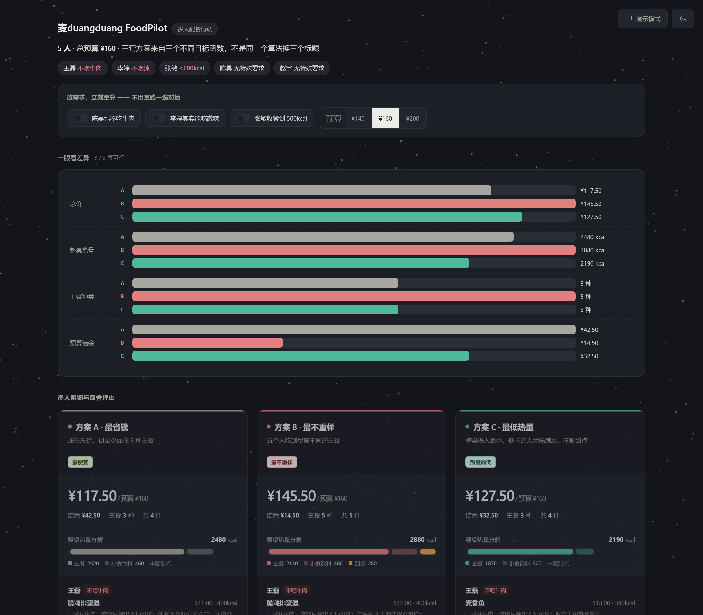

# 别让大模型算钱：我用麦当劳 MCP 做了个多人配餐 Agent

> 项目：麦duangduang FoodPilot｜仓库：https://github.com/oldruntu1205/mcduangduang-foodpilot
> 本文是工程复盘，重点不是"我做了什么"，而是"我在哪里判断错了、后来怎么改的"。



## 一、一个能把人逼疯的场景

五个人点麦当劳，预算 160。

一个不吃牛肉，一个不能吃辣，一个在控热量。

现在你要下单。真实流程是这样的：

群里发一句"点麦当劳了，报一下忌口"，然后等。有人说"我都行"，有人三小时后才回，有人回"随便"但你记得他上次不吃香菜。你去小程序翻菜单，算价格，发现超了，删掉一份薯条，再算。然后有人说"等等我其实不吃牛肉"。

十分钟过去了，还在问"到底谁不吃啥"。

**这件事的卡点从来不是"吃什么"，是协调。**

多人约束 + 预算，本质是一道组合优化题：5 个人、每人有一组可行集、还要塞进一个总预算、还要满足整桌热量目标。人来算会算错，AI 来算……也会。

---

## 二、第一次尝试：让大模型直接算

我最初的做法很自然——把需求丢给模型，让它输出方案。

方案确实输出了，看起来还挺合理。然后我核对了一遍账：

- 报的总价 **163.5 元**，而预算是 160
- 五个人里有一个"不吃牛肉"，它给那人排了一份巨无霸
- 我把同样的问题再问一次，价格变成了 **155.8**

三次提问，三个答案。而且我看不出 163.5 是怎么加出来的——它没有给过程。

这时候容易得出一个错误结论："模型能力不够，换个更强的模型。"

**但更准确的说法是：任务类型错了。**

---

## 三、算账不是语言问题

大模型擅长的是**语言**，而这件事需要的是**搜索 + 约束满足**。三类任务混在一起时，最容易出事的是最不像语言的那个。

落地失败通常有三种形态：

**1. 不可复现。** 同样的输入，三次三个价格。因为它是"生成"一个答案，不是"计算"一个答案。

**2. 不可验证。** 163.5 这个数字，你没法指着一行代码说"这里错了"。你只能整体重算一遍，然后再猜。

**3. 不可解释。** 它会告诉你"这款最受欢迎"，但这不是解释。真正的解释必须能回答：**为什么是它，不是另一个？它牺牲了什么？**

这三条里，第 3 条最致命。因为用户不同意方案时，需要的是一个可以反驳的着力点。如果理由是一句形容词，用户只能全盘推翻重来。

---

## 四、分工：让模型管说话，让代码管算账

所以我把职责切开，切得很彻底：

| 层 | 负责 | 明确不负责 |
| --- | --- | --- |
| 大模型 | 听懂人话（谁不吃什么、预算多少）、追问缺失项、把方案讲成人话 | **不做金额加总、不做约束校验、不求最优解** |
| 求解器 | 可行性判定、组合枚举、多目标优化、生成可验证理由 | 不做自然语言理解、不写话术 |
| MCP Server | 门店、菜单、营养、券、价格的**事实来源** | 不做组合优化 |

这条纪律带来的一个硬性后果：**页面上、对话里的每一个数字，都必须能追溯到求解器的那一次输出或 `calculate-price` 的返回。没有任何一处是模型算的。**

听起来很严格，但它解决了一个非常实际的问题——出了问题我能定位。是接口给的价不对，还是我枚举漏了，还是展示时算错了，三条路径分得很清楚。

---

## 五、三套方案，为什么不能是"同一个算法换三个标题"

给用户 2–3 套方案，是这类产品的标配。我第一版用加权打分：

```python
score = 0.4 * 价格项 + 0.4 * 多样性项 + 0.2 * 热量项
```

跑出来三套方案，调三组权重，起了三个名字：省钱版、均衡版、健康版。

然后我自己切换了一下，发现问题很大：**三套方案几乎一模一样**。改一个权重，从 0.4 调到 0.5，结果不变；调到 0.7，才换一个菜。

用户只要点两下就会发现这是个障眼法。可解释性在这一刻就没了。

**改法：换成三个目标函数。**

不再调权重，而是让每套方案有自己的优化目标，然后各自取最优：

| 方案 | 目标函数 | 5 人 / ¥160 实测 |
| --- | --- | --- |
| A 最省钱 | `min 总价`，附"至少 3 种主餐"下限 | **¥117.50** / 3 种主餐 / 2480 kcal |
| B 最不重样 | `max 主餐种类`，同种类下取便宜 | **¥145.50** / 5 种主餐 / 2880 kcal |
| C 最低热量 | `min 整桌热量`，低卡名额加权、禁配甜点 | **¥127.50** / 3 种主餐 / 2190 kcal |

实现上不复杂：每人取候选前 5 项，枚举笛卡尔积（5 人 = 3125 组），对每组套上共享小食、校验预算，然后用该方案自己的目标函数打分，取最优。

3125 组在浏览器里跑不到 10 毫秒，慢一点完全可以接受。

**收益是差异变成了结构性的**，而不是参数性的。A 便宜但三个人吃同款，B 最贵但五个人不重样，C 热量最低但砍了甜点。三条都能一句话讲清楚，用户选哪套是在做真实的权衡，不是在看随机数。

---

## 六、可解释 = 可验证的事实 + 承认取舍

这是我认为整个项目最值得写的一段。

「可解释」很容易被写成形容词堆砌。我给自己定的标准是：**每条理由必须包含可验证的数字，并且必须承认牺牲了什么。**

反例（我第一版写出来的）：

> 这款性价比最高，符合您的需求。

正例（现在实际输出的）：

> 避开牛肉，该店只筛出 8 项可选；比最低价的脆鸡排蛋堡贵 ¥6.00，用来凑够 3 种不同主餐，避免整桌一个味。

差别在哪？

- **有数字**：8 项、¥6.00、3 种。用户可以自己核对。
- **有对比**：说的是"比 X 贵多少"，而不是孤立地夸自己。
- **有取舍**：明确承认"我多花了 6 块，目的是不让你五个人吃一样的东西"。

用户看到这句，可以直接反驳："那别凑种类了，就吃便宜的。" —— 这是一个**可以被反驳**的方案，而"性价比最高"没法反驳，只能接受或拒绝。

可解释性的价值不在于让 AI 显得有道理，**在于让用户有地方下手。**

---

## 七、一个我改了四次的 bug

这段是我觉得最真实的部分。

做完求解器、跑通测试之后，我开始做可视化页面。为了体现"低卡方案不配甜点"这个决策，我加了一条热量堆叠条：主餐一段、小食饮料一段、甜点单独一段。

然后截图一看，愣住了：

**「最低热量」方案，整桌热量比「最省钱」方案还高。**

C 方案 2760 kcal，A 方案 2480 kcal。名字叫"最低热量"，结果最高。

顺着查下去，根因很朴素：

> 低卡方案的预算约束不同，共享小食的挑选逻辑里，排序键用的是**价格**（挑最便宜的），于是补位时补进了一份 280 kcal 的麦旋风。

主餐确实选了最低卡的，但小食把优势全吃回去了。

修复只改了一行：低卡方案的共享小食按**热量**排序。

```js
const key = st.id === 'C'
  ? (a, b) => a.kcal - b.kcal || a.price - b.price   // 低卡方案按热量挑
  : (a, b) => a.price - b.price || a.kcal - b.kcal;  // 其他按价格挑
```

这个 bug 让我重新理解了一件事：

**目标函数不只是用来选主餐的。方案里的每一个子决策——挑小食、挑饮料、要不要甜点——都必须服从同一个目标。** 只要有一个子决策按别的口径走，整个方案的最优性就是假的。

而且这个 bug 是**永远不会被自动化测试抓到**的那种。它不违反任何硬约束：不超预算、不违反忌口、不超热量上限，所有不变量都通过。

它只违反了一件事：**方案的名字和方案的实际效果不一致。**

最后是靠人眼看截图发现的。这也是为什么我坚持每个版本都要真的把页面打开看一眼。

---

## 八、关于 MCP：不要自己造轮子

这个项目最初的想法其实是"自己写一个麦当劳下单 MCP"。查完资料我放弃了这个方向：

麦当劳中国 2025 年 12 月就上线了官方 MCP 服务（`mcp.mcd.cn`，Streamable HTTP + Bearer Token），目前 **33 个工具**，覆盖麦乐送、到店自取、得来速、企业团餐、积分商城、领券、营养查询。限流 600 次/分钟，免费。

也就是说，自建一个 MCP Server，等于给官方服务包一层壳。

**真正稀缺的不是协议层，是编排层。**

所以我把精力放在"用哪些工具、按什么顺序用、哪些不该用"上。33 个工具里，这个项目实际编排了 15 个：

- 定门店取菜单：`query-nearby-stores`、`query-meals`
- 约束复核：`query-meal-detail`（凡涉及忌口必查）、`list-nutrition-foods`
- 价格与下单：`calculate-price`、`create-order`、`query-order`、`cancel-order`
- 券与辅助：`query-my-coupons`、`auto-bind-coupons`、`now-time-info` 等

剩下 18 个（积分商城、抽奖、主题活动预约、团餐对接）**明确不用**。

理由很简单：**工具面越宽，Agent 的误触发概率越高。** 33 个全接一遍不是本事，知道哪些不该接才是。

顺带一个安全细节：`query-meal-detail` 是必须的。因为菜名关键词识别一定会误判——比如「吉士」其实是牛肉饼，纯靠字符串匹配会把「培根蔬萃双层牛堡」判成猪肉。所以凡识别不出肉类成分的餐品，一律回查详情，且不允许分配给有忌口的人。宁可方案丑，不可方案错。

---

## 九、一个工程取舍：两个求解器

页面要做到「双击即开、断网可用、点开关立刻重算」，就不能依赖本地服务。

所以我把求解器翻译成 JS 内嵌进页面。代价很明确：**算法有了两份实现**（Python 一份、JS 一份）。

这种事靠自觉维护迟早出事。我做了三层保障：

| 层 | 手段 | 抓什么 |
| --- | --- | --- |
| 源码 | `solver_core.js` 是唯一 JS 源码，生成器读它内嵌，**不存副本** | 防止长出第三份 |
| 测试 | `test_parity.js` 逐项比对总价/种类/热量/**选品编码**/**理由文案** | 漂移、排序偏差、文案变形 |
| 运行时 | 页面启动用内嵌 baseline 自校，不一致在页脚告警 | 万一还漏了，现场能被看见 |

第二层里最严格的一项是**比对理由文案**。因为"交互后理由措辞悄悄变了"是最难察觉的漂移——数字对了，但解释变了，用户会觉得这个 AI 前后不一致。

目前的测试状态：

```text
6 个求解场景不变量自检      → 全过
24 组调节台组合            → 全过（无异常、无 NaN、无超预算、无忌口违规）
Python/JS 双求解器等价性    → 全过，理由文案逐字一致
页面出厂检查 18 项         → 18/18
```

---

## 十、一个有意思的发现

测试 24 组开关组合时发现：

**预算 ¥160 时，点「陈昊也忌牛肉」，结果完全不变**——因为他本来就没吃到牛肉。

**但预算 ¥200 时，同一个开关会让方案整体重排**——A 方案从 ¥130 降到 ¥124。

这说明了一件事：**改一个人，不等于换一份菜。**

需求变动后腾出来的预算，会改变其他所有人的最优解。所以任何一条约束变化都必须整体重解，不能局部替换。手改一份，大概率踩预算，或者让另一个人失去最优。

这是多人协调最反直觉的地方，也是这个项目存在的理由。

---

## 结语

这类 Agent 的价值不在"能聊"，在"敢交付"。

用户说"就这个，下单吧"，意味着他相信这个方案的每一个数字。这份信任不能建立在"模型看起来很聪明"上，只能建立在"每一步都能被验证"上。

所以我的做法很朴素：**把不确定的部分（理解、表达）交给模型，把确定的部分（计算、校验）全部交给代码。**

模型负责听懂"有个不吃牛的"，代码负责保证那个人面前不会出现巨无霸。

---

*项目地址：https://github.com/oldruntu1205/mcduangduang-foodpilot*
*麦当劳 MCP 官方文档：https://github.com/M-China/mcd-mcp-server*
*本项目为参赛作品，非麦当劳官方产品。*
